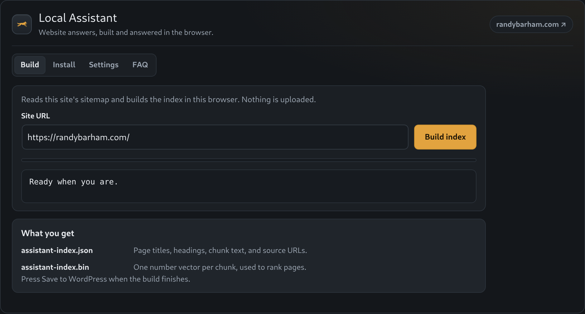

<div align="center">


# Grey Local Site AI Assistant

**A chat button for your website that answers from your own pages — in the visitor's browser.**

No server, no API key, and no question leaves the device. Every answer names the page it came from, and when the pages do not contain the answer it says so instead of inventing one.

<a href="https://wordpress.org/plugins/grey-local-site-ai-assistant">

</a>

### Now in the WordPress Plugin Directory

**Approved by the Plugins Team** — [grey-local-site-ai-assistant](https://wordpress.org/plugins/grey-local-site-ai-assistant).
Install it from your WordPress dashboard (Plugins → Add New → search
"Grey Local Site AI Assistant"); this repo is its full readable source.

[](https://github.com/greyok00/local-assistant/releases)
[](https://wordpress.org/plugins/grey-local-site-ai-assistant)
[](LICENSE)

[Overview](#overview) · [Screenshots](#screenshots) · [How it works](#how-it-works) · [Install](#quick-start) · [Settings](#settings) · [Privacy](#privacy)

</div>

---

## Overview

Grey Local Site AI Assistant puts a small chat button on your site. Opening the
panel starts the install automatically — there is no separate consent step.
After that the models stay cached on the visitor's device, so the assistant
works on every page and keeps working offline.

The assistant is available as a WordPress plugin in the
[WordPress Plugin Directory](https://wordpress.org/plugins/grey-local-site-ai-assistant)
and as a static-site build. This repository is the full readable source.

**Version 0.3.16 · Static sites and WordPress · GPL-2.0-or-later**

## Screenshots

| Builder | WordPress settings |
| :---: | :---: |
|  |  |

The builder has four tabs — **Build**, **Install**, **Settings** and **FAQ** —
both on the static dashboard and inside `wp-admin`.

## What the visitor gets

A small button in the bottom-right corner. Opening the panel starts the install;
after that the models stay cached, so the answer arrives without a round trip to
a server. The widget reads the page it sits on and derives its panel,
transcript, borders, muted text and label colour from the page's own tokens.
It keeps listening, so flipping a light/dark toggle repaints the open panel
without a reload.

## How it works

1. **Read the index.** At build time the site is crawled from its sitemap (up to
   `maxPages`, 500 by default) and split into overlapping passages — 180 words
   with 40 words of overlap, each prefixed with its section heading. The
   embedding model `all-MiniLM-L6-v2` turns every passage into a 384-dimension
   vector. The result is two files: vectors and metadata.
2. **Retrieve.** The question is embedded the same way, then scored against
   every passage with cosine similarity plus a keyword-overlap bonus. The top
   `topK` passages (6 by default) are kept.
3. **Refuse, if the evidence is thin.** The best passage must score at least
   `relevanceThreshold` (0.35) and contain at least two of the question's
   content words — or its only word, for a one-word question. Embeddings find
   topical neighbours, not answers. If nothing survives, the visitor gets the
   closest pages as suggestions instead of a made-up answer.
4. **Generate.** On a browser with WebGPU, `SmolLM2-360M-Instruct` runs on the
   GPU. Without it, a smaller `SmolLM2-135M-Instruct` runs in a Web Worker on
   the CPU, so the page never freezes while it thinks.
5. **Ground the answer.** The model is told to answer only from the numbered
   notes, cite the note number in brackets, and reply `NOT_COVERED` rather than
   guess. The reply is checked against the passages; a weak answer gets one
   clean retry, and a refusal is shown as a refusal.
6. **Show the source.** The citation names the page, and the answer's first
   line stays attached to it rather than buried under a list of links.

The page text is treated as data throughout. Bracketed numbers and "Note N" are
stripped from a passage before the model sees it, and the system prompt frames
every passage as data rather than instructions — so a page that says `[2]` or
`Note 2` cannot promote itself above the real sources.

## What it costs

The index is small — two files of text and vectors. The models are the weight:
the GPU model and its embedder are roughly 225 MB at first load; the CPU model
is smaller. Both stay cached on the device after the first load, so a returning
visitor downloads nothing. The widget and the index are precached by the
service worker, which is why the assistant survives a dropped connection.

Questions, passages and answers are never sent anywhere. The only third-party
requests are for the model files, and those can be self-hosted if a deployment
forbids them.

## Quick start

### Static site

1. Download the current static ZIP from
   [Releases](https://github.com/greyok00/local-assistant/releases) and unpack it.
2. Copy the `local-assistant-<version>/` folder to your site, for example as
   `/assistant/`. It is already built; the folder is about 37 MiB, most of it
   the vendored model runtimes.
3. Add this line before `</body>` on every page where the button should appear:

   ```html
   <script type="module" src="/assistant/loader.js" data-assistant></script>
   ```

4. Open `/assistant/dashboard.html`, enter your site's URL, and press
   **Build index**.
5. Download the two index files and upload them beside the assistant as
   `assistant-index.json` and `assistant-index.bin`. If you install the files
   elsewhere, set `indexPath` in the Settings tab to match.

### WordPress

1. Install **Grey Local Site AI Assistant** from the WordPress Plugin
   Directory, or download the current WordPress ZIP from Releases.
2. In WordPress, open **Plugins → Add New → Upload Plugin**, choose the ZIP,
   then activate it.
3. Open **Settings → Local Assistant**. The same four tabs are there: Build,
   Install, Settings and FAQ.
4. On the **Build** tab, press **Build index**. The plugin saves the result to
   `wp-content/uploads/local-assistant/` for you.
5. The button appears on every public page; no theme edit is needed.

## Build the index

Both installs work the same way: the index is built in the browser from the
site's own pages.

1. Enter the site URL on the **Build** tab. The builder reads the sitemap.
2. Press **Build index** and leave the tab open. The progress bar shows pages
   read and passages embedded.
3. When it finishes, save the index. On a static site you download two files; on
   WordPress the plugin stores them for you.
4. Rebuild when you add or change pages that matter. The old index keeps working
   until you replace it.

A page that is not in the sitemap is not in the index, and a page behind a login
is never read — the assistant runs in the visitor's browser and only sees what
a visitor can open.

## The four tabs

| Tab | What it is for |
|---|---|
| Build | Enter the site URL, build the index, see progress |
| Install | The script tag for static sites, the plugin steps for WordPress |
| Settings | Assistant name, greeting, answer limits, model paths |
| FAQ | Eight answers, collapsed until opened |

## Settings

The static build reads `assistant.config.json`; the WordPress plugin stores the
same keys in its options.

| Key | Default | What it changes |
|---|---|---|
| `assistantName` | `AI Assistant` | Title on the widget |
| `greeting` | `Ask about the pages on this site` | Input placeholder |
| `indexPath` | `/assistant-index` | Where the two index files live |
| `relevanceThreshold` | `0.35` | Below this score — or when a passage lacks enough of the question's own words — the assistant declines instead of guessing |
| `topK` | `6` | Passages given to the answer model |
| `maxAnswerWords` | `120` | Longest answer |
| `maxPages` | `500` | Pages read in one build |
| `accent` | `#e8622c` | Used only when the page exposes no colour |
| `modelBaseUrl` | `""` | Where the chat model weights come from |
| `modelMirror` | `""` | Self-hosted copy of the model files |

## If the button does not appear

- **The script tag is missing or points at the wrong path.** View source and
  check that `/assistant/loader.js` loads; the browser console names the 404.
- **The site is not on HTTPS.** Browsers only run the models on a secure
  origin. `localhost` counts as secure for testing.
- **The index was never built.** The button still appears, but every answer says
  nothing relevant was found.
- **The page is behind a login.** The assistant runs in the visitor's browser,
  so it only sees pages a visitor can open.

## Requirements

- HTTPS in production. Browsers require a secure origin for the models and the
  service worker; `localhost` is fine for testing.
- Any current browser, desktop or phone. Where WebGPU is available the model
  runs on the GPU; a browser without it answers with the smaller CPU model.
- The first visit downloads the models once. The GPU model and its embedding
  model are about 225 MB together; the CPU model is smaller.

## Development

```bash
cd product
npm ci
npm run build     # rebuild dist/ and dist/wordpress/
npm test          # 171 tests
npm run release   # versioned static and WordPress zips + SHA256SUMS
```

`src/` is the source; `dist/` is generated and never edited by hand. The build
minifies and strips comments, and the release script refuses to ship source
maps, absolute home paths, email addresses or token-shaped strings.

## Documentation

- [`docs/ASSISTANT-WORKFLOW.md`](docs/ASSISTANT-WORKFLOW.md) — how an index is built and used

## License

GPL-2.0-or-later. See [LICENSE](LICENSE).
