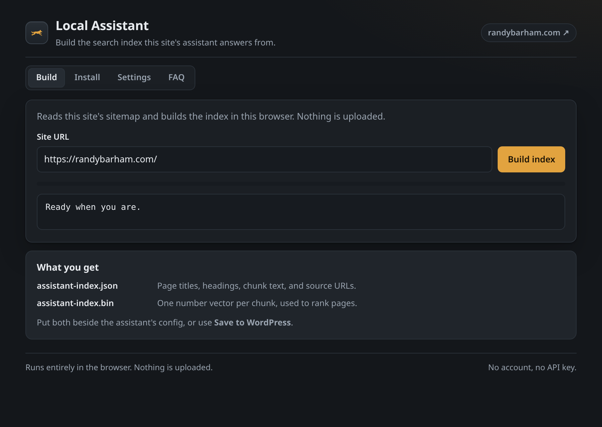

<div align="center">

# Grey Local Site AI Assistant

**A browser-local assistant that answers questions from your own pages. No
server, no API key, and nothing ever leaves the device.**

[](LICENSE)
[](product/src)
[](.github/workflows/ci.yml)
[](https://wordpress.org/plugins/grey-local-site-ai-assistant)

</div>

> **As featured on WordPress.org** — approved by the Plugins Team and listed in
> the official Plugin Directory:
> **[grey-local-site-ai-assistant](https://wordpress.org/plugins/grey-local-site-ai-assistant)**.
> The same browser-local assistant, installable from your WordPress dashboard
> with one click; this repo is its full readable source (see the
> plugin readme's Source Code section on its WordPress.org page for the
> build mapping and the third-party library sources).

## What is it?

It is a chat panel that a site owner drops onto any site. The visitor asks a
question, the widget finds the most relevant passages in the site's own pages,
and a small language model running inside the visitor's browser writes the
answer and cites the page it came from. When the pages do not contain the
answer, the assistant says so instead of inventing one.

There is nothing to host and no key to buy. Retrieval and generation both run
on the visitor's device, one engine on the GPU and a smaller one on the CPU
when WebGPU is unavailable, with a plain quoted passage as the last resort.
A service worker caches the widget and the index, so the assistant keeps
working offline.

A live example runs at
[randybarham.com/research](https://randybarham.com/research/), where the
Research Library serves this runtime over 401 modules across five domains.



## Features

| Feature | What it does |
|---|---|
| Grounded answers | Retrieval scores passages by cosine similarity plus keyword overlap, and refuses when the best evidence falls below `relevanceThreshold` |
| Two model engines | SmolLM2-360M on WebGPU for speed, SmolLM2-135M through Transformers.js on the CPU when there is no WebGPU, chosen automatically |
| Search fallback | If neither engine can start, the top passage is quoted verbatim with its page named, so nothing can be invented |
| Answer guards | Fence echoes, ungrounded wording, repetition loops, and invented names are detected and replaced by a refusal |
| Browser index builder | A dashboard crawls the sitemap, extracts readable text, and embeds chunks into two artifact files, all in the browser |
| Offline support | A service worker precaches the widget and the index, so returning visitors never repeat the download |
| Auto theming | The widget derives its palette from the host page's tokens and follows light/dark toggles live, with enforced contrast |
| Self-hosted models | `modelBaseUrl`, `modelLibUrl`, and `modelMirror` point every model weight at your own host instead of a public CDN |
| WordPress wrapper | A plugin that serves the runtime, exposes the config over REST, and stores the index under `wp-content/uploads/` |

## Install and use

| Shipping form | Steps | Start here |
|---|---|---|
| WordPress plugin | Upload the zip to Plugins, Activate, then press Build index under Settings | `product/wordpress/readme.txt` |
| Static-site drop-in | Unpack the release folder, add one `<script>` line before `</body>`, build the index in `dashboard.html`, upload the two index files | `product/` (`npm run build` output) |
| Demo and bench | Clone, `npm ci && npm run build`, then run the demo tenant and bench harness | `demo/` |

## Privacy

What leaves the machine: nothing. Questions, page text, passages, and answers
are never transmitted anywhere, the browser alone talks to the site itself,
and there is no analytics or telemetry call.

What downloads: model weights only, and only after the visitor accepts the
consent card. The GPU path fetches about 225 MB (chat model, embedder, and the
WebGPU wasm) once, then the browser cache serves every later visit. A
deployment that forbids third-party requests can mirror every file on its own
origin and set three config keys; the shipped runtime then makes no external
request at all.

## Development

Development: built with AI assistance and verified by tests and CI.

```
cd product
npm ci
npm test          # unit suite, node --test
npm run build     # rebuild dist/ (never hand-edited)
npm run release   # versioned zips + SHA256SUMS
```

Licensed GPL-2.0-or-later, see [LICENSE](LICENSE). The bundled `product/vendor`
runtime libraries (transformers.js, WebLLM: both Apache-2.0) are version-pinned
in `package.json` and regenerated by `scripts/vendor.mjs`; their notices ship
with the plugin in `product/wordpress/THIRD-PARTY-NOTICES.txt`.
